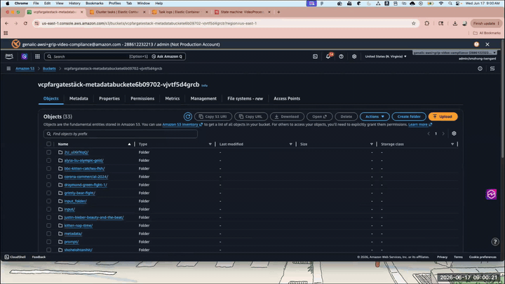
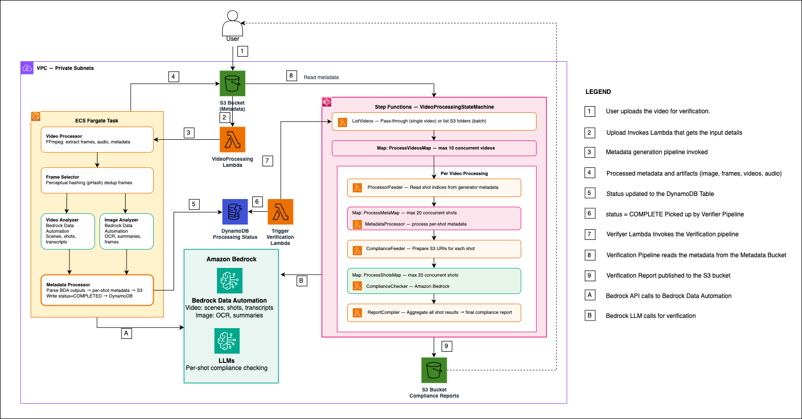

<p align="center">
  <h1 align="center">🎬 Video Compliance Agent</h1>
</p>

<p align="center">
  <a href="#"></a>
  <a href="#"></a>
  <a href="#"></a>
  <a href="#"></a>
  <a href="LICENSE"></a>
</p>

<p align="center">
  <em>End-to-end automated video compliance verification pipeline powered by AWS Bedrock, ECS Fargate, and Step Functions.</em>
</p>

<p align="center">
  <b>Chun-Hao Liu, Avinash Yadav, Amaran Asokkumar, Shannon Zhong, Jyotsna Masand, Vidhya Kasiraman, Rahul Ghosh, Meghana Ashok, Gaurav Rele, Vidya Sagar Ravipati</b>
</p>

---

## 📖 Summary

Video Compliance Agent is an end-to-end pipeline built on AWS that automatically verifies video content against broadcast compliance guidelines (e.g., Ofcom). It processes videos shot-by-shot — extracting frames, audio transcripts, OCR text, and AI-generated scene descriptions — then runs each shot through an LLM to flag potential violations, producing a structured per-shot compliance report in JSON and CSV format.

The solution replaces manual, time-consuming video review workflows. Content teams can upload any video and receive a detailed compliance report in minutes, with flagged moments linked directly to shot timestamps for efficient human review. It scales to handle multiple videos in parallel and supports customizable compliance guidelines.

---

## 🎬 Demo

<p align="center">
  
</p>

<p align="center">
  <em>Demo: Upload a video → automatic metadata extraction → compliance verification → structured report. Shown at 2× speed. Full version: <a href="docs/vca-demo.mp4">vca-demo.mp4</a></em>
</p>

---

## 🏗️ Architecture

<p align="center">
  
</p>

<p align="center">
  <em>Two event-driven pipelines — a Generator (metadata extraction) and a Verifier (compliance checking) — connected via DynamoDB inside a VPC with private subnets.</em>
</p>

**Generator Pipeline**

1. 📤 **Upload** — User drops a video into the `input/` prefix of the S3 bucket
2. ⚡ **Trigger** — S3 event invokes the VideoProcessing Lambda
3. 🐳 **Process** — ECS Fargate task runs: Video Processor → Frame Selector → Video Analyzer + Image Analyzer (parallel) → Metadata Processor
4. 💾 **Store** — Processed metadata and artifacts written to S3
5. ✅ **Signal** — DynamoDB status set to `COMPLETED`

**Verifier Pipeline**

6. 📡 **Stream** — DynamoDB Stream surfaces `COMPLETED` status
7. 🚦 **Orchestrate** — Step Functions `VideoProcessingStateMachine` kicks off
8. 🔍 **Verify** — `ListVideos` → `ProcessMetaMap` → `ComplianceFeeder` → `ProcessShotsMap` → `ReportCompiler`
9. 📋 **Report** — Final compliance report published to S3

**Bedrock Integrations**
- **A** — Generator calls **Bedrock Data Automation** (scenes, shots, transcripts, OCR)
- **B** — Verifier calls **Bedrock LLM** for per-shot compliance reasoning

<details>
<summary>📝 Text-based flow (click to expand)</summary>

```
Upload Video (S3)
    ↓
S3 Event → Lambda Trigger
    ↓
ECS Fargate Task (Generator)
    ├─ Video Processor (FFmpeg)
    ├─ Video Analyzer (Bedrock)
    └─ Image Analyzer (Bedrock)
    ↓
DynamoDB Status Update
    ↓
DynamoDB Stream → Lambda Trigger
    ↓
Step Function (Verifier)
    ├─ Metadata Processor
    ├─ Compliance Checker (Bedrock LLM)
    └─ Report Compiler
    ↓
Compliance Report (S3)
```
</details>

---

## ⚡ Key Features

| Feature | Description |
|---------|-------------|
| 🔄 **Fully Automated** | Upload a video → get a compliance report. No manual intervention. |
| 🎯 **Event-Driven** | S3 triggers Generator; DynamoDB Stream triggers Verifier. Decoupled and resilient. |
| 📐 **Per-Shot Analysis** | Videos are split into shots — each independently reviewed against compliance guidelines. |
| ⚙️ **No Hardcoded Values** | All resources created dynamically by CDK. No `.env` files needed. |
| 📏 **Scalable** | Configurable concurrency (up to 10 parallel shots, 20 parallel metadata). Multiple videos processed simultaneously. |
| 🎛️ **Tunable** | Single knobs for frame rate, deduplication threshold, parallelism, and model selection. |
| 📑 **Customizable Guidelines** | Swap compliance rules by editing a single text file. |
| 🔁 **Dual Mode** | Automatic (event-driven) or manual (S3 URI batch) execution. |

---

## 🚀 Quick Start

### Prerequisites

- AWS CLI configured with appropriate credentials
- Node.js 18+ and npm
- Python 3.11+
- Docker (or Finch/Colima) — required for building container images
- AWS CDK CLI: `npm install -g aws-cdk`

> **Note:** CDK resolves the target account from your active AWS credentials. `deploy.sh` deploys to `us-east-1` by default (required for Bedrock models). Override with `AWS_REGION=<region> ./deploy.sh`.

### First-Time Setup: Bootstrap

If the target account and region have never been used with CDK, bootstrap once:

```bash
cdk bootstrap aws://<ACCOUNT_ID>/<REGION>
```

### Deploy

```bash
cd video-compliance-agent
./deploy.sh
```

The script automatically:
1. Deploys Generator stack (ECS + Lambda + DynamoDB)
2. Captures outputs (bucket name, stream ARN)
3. Deploys Verifier stack (Step Functions + Lambda)
4. Configures all integrations

### Run

```bash
# The region you deployed to (us-east-1 unless overridden)
REGION=<REGION>

# Get bucket name from deployment output
BUCKET=$(aws cloudformation describe-stacks --stack-name VCPFargateStack \
  --region ${REGION} \
  --query "Stacks[0].Outputs[?OutputKey=='MetadataBucketName'].OutputValue" --output text)

# Upload video — triggers entire pipeline automatically.
# The video can live anywhere on your machine; only the s3://.../input/ destination matters.
aws s3 cp <path-to-video>.mp4 s3://${BUCKET}/input/ --region ${REGION}
```

---

## 📊 Capabilities

### 🎞️ Video Length & Throughput

- Handles **short-form ads through long-form content** (tested: ~30-second clips up to 33+ minute videos)
- Short-form videos (~30s) complete end-to-end in roughly **4 minutes**
- Long-form videos (33+ min) complete the verifier stage in **under 20 minutes**

### 🔀 Concurrency & Scale

- Step Functions `Map` with **configurable `maxConcurrency`** (default 10 for shots, 20 for metadata) — up to 10 shots verified in parallel
- **Parallel video runs** — multiple videos uploaded simultaneously flow through independent pipelines
- Built-in **retry and exponential backoff** for Bedrock throttling

### 🎯 Per-Shot Compliance Output

- Videos split into **shots**, each independently reviewed against loaded compliance guidelines
- Output: **per-shot structured JSON**, aggregated into a single final report
- Flags include **shot index and metadata** for direct navigation to flagged moments

### 🏷️ Flag Categories

- **On-screen text / OCR** — text content surfaced in frames
- **Violence** and other policy categories
- Fully **configurable** by editing the compliance guideline file

---

## 📁 Repository Structure

```
video-compliance-agent/
├── README.md
├── deploy.sh                              # One-click deployment script
├── LICENSE
├── docs/
│   ├── VCA_arch.png                       # Architecture diagram
│   ├── vca-demo.gif                       # Demo GIF
│   └── vca-demo.mp4                       # Full demo video
├── generator/                             # 🐳 Generator Pipeline (ECS Fargate + CDK)
│   ├── app.py                             # CDK app entry point
│   ├── cdk.json
│   ├── requirements.txt
│   ├── lambda/
│   │   └── trigger-generator/             # S3 event trigger Lambda
│   └── vcp_2a/
│       ├── fargate_ecs.py                 # CDK stack: ECS + S3 + DynamoDB
│       └── images/
│           ├── frame_selector/            # pHash deduplication
│           ├── image_analyzer/            # Bedrock Data Automation (images)
│           ├── metadata_processor/        # Aggregates BDA outputs
│           ├── video_analyzer/            # Bedrock Data Automation (video)
│           └── video_processor/           # FFmpeg frame/audio extraction
└── verifier/                              # 🔍 Verifier Pipeline (Step Functions + CDK)
    ├── requirements.txt
    ├── prompt/
    │   └── ofcom_broadcast_guidelines_v4.txt  # Default compliance rules
    └── backend/
        ├── bin/                            # CDK app entry point
        ├── lib/
        │   └── backend-stack.ts           # CDK stack: Step Functions + Lambdas
        └── lambda/
            ├── compliance-checker/        # 🧠 LLM compliance reasoning
            ├── compliance_feeder/         # Prepares S3 URIs per shot
            ├── list_video_step/           # Lists videos for batch mode
            ├── metadata-processor/        # Reads generated metadata
            ├── processor_feeder/          # Prepares metadata S3 URIs
            ├── report_complier/           # Aggregates final report
            └── trigger-verifier/          # DynamoDB Stream trigger
```

---

## 📦 Components

### Generator Stack (`VCPFargateStack`)

| Resource | Purpose |
|----------|---------|
| 🪣 S3 Bucket | Stores videos and generated metadata |
| 📊 DynamoDB Table | Tracks processing status with Streams enabled |
| 🐳 ECS Cluster | Fargate tasks for metadata generation |
| ⚡ Lambda Function | Triggers ECS task on S3 upload |
| 🌐 VPC | Private subnets with NAT Gateway |

**Containers:**
1. **Video Processor** — FFmpeg extraction (frames at configurable fps, audio)
2. **Frame Selector** — pHash deduplication to remove near-duplicate frames
3. **Video Analyzer** — Bedrock Data Automation for video-level analysis
4. **Image Analyzer** — Bedrock Data Automation for per-frame analysis
5. **Metadata Processor** — Aggregates BDA outputs into per-shot metadata

**Trigger:** S3 `ObjectCreated` on `input/` prefix (`.mp4`, `.mov`, `.avi`, `.mkv`)

### Verifier Stack (`VCP-2-BackendStack`)

| Resource | Purpose |
|----------|---------|
| 🪣 S3 Bucket | Stores compliance reports |
| 📊 DynamoDB Table | Tracks verification state |
| 🔄 Step Function | Orchestrates compliance workflow |
| ⚡ Lambda Functions | Metadata processing, compliance checking, reporting |
| 📡 Lambda Trigger | DynamoDB Stream listener |

**Workflow:**
1. `ListVideos` — single video (from trigger) or batch (from S3 URI)
2. `ProcessMetaMap` — parallel metadata preparation (max 20)
3. `ProcessShotsMap` — parallel compliance checks (max 10)
4. `ReportCompiler` — aggregates into final report

---

## ⚙️ Configuration

### Generator Trigger

```python
# generator/vcp_2a/fargate_ecs.py
metadata_bucket.add_event_notification(
    s3.EventType.OBJECT_CREATED,
    s3n.LambdaDestination(trigger_lambda),
    s3.NotificationKeyFilter(prefix="input/", suffix=".mp4")
)
```

**Supported formats:** `.mp4`, `.mov`, `.avi`, `.mkv`

To add formats, update `generator/lambda/trigger-generator/function.py`:
```python
if not key.lower().endswith(('.mp4', '.mov', '.avi', '.mkv', '.webm')):
```

### Verifier Trigger

The DynamoDB Stream trigger in `verifier/backend/lib/backend-stack.ts`:

```typescript
triggerLambda.addEventSource(new DynamoEventSource(generatorTable, {
  startingPosition: lambda.StartingPosition.LATEST,
  batchSize: 10,
  retryAttempts: 3
}));
```

### Dual Mode Execution

| Mode | Trigger | Use Case |
|------|---------|----------|
| **Automatic** | DynamoDB Stream | Single video, triggered by generator completion |
| **Manual** | S3 URI input | Batch processing or re-running verifier on existing metadata |

```bash
# Manual mode — re-run verifier without re-running generator
aws stepfunctions start-execution \
  --state-machine-arn <ARN> \
  --input '{"s3uri": "s3://bucket/input_folder/"}'
```

### Change Model

Set `MODEL_ID` in `verifier/backend/lib/backend-stack.ts`:
```typescript
MODEL_ID: 'us.amazon.nova-2-lite-v1:0',
```

> **💡 Note (June 2025):** Nova Premier is legacy. The recommended replacement is **Amazon Nova 2 Lite** (`us.amazon.nova-2-lite-v1:0`) — 7× lower cost, up to 5× faster inference, 1M token context window, extended thinking, and built-in tools.

---

## 🎛️ Hyperparameters

### Generator Pipeline (Fargate)

| Knob | Location | Default | Effect |
|------|----------|---------|--------|
| Frame extraction rate | `video_processor.py` (`frame_rate`) | `2` fps | ↑ more frames → better coverage, higher cost; ↓ faster + cheaper |
| pHash dedupe threshold | `PHASH_THRESHOLD` env var | `0.70` | ↑ more frames kept; ↓ more aggressive dedup |
| Image analyzer parallelism | `MAX_PARALLEL_IMAGES` env var | `5` | Concurrent BDA invocations per video |
| BDA polling interval | `POLLING_INTERVAL` | `15s` / `30s` | Check interval for BDA job status |
| Fargate task size | `fargate_ecs.py` | 4 vCPU / 16 GB | ↑ → faster FFmpeg + pHash |

### Verifier Pipeline (Step Functions + Lambda)

| Knob | Location | Default | Effect |
|------|----------|---------|--------|
| Frames per shot | `compliance_checker.py` (`num_images`) | `30` | Frames sent to LLM per shot. Biggest cost lever. |
| Sampling buckets | `content_builder_nova.py` | `10` | Temporal coverage uniformity |
| LLM model | `MODEL_ID` env var | `us.amazon.nova-2-lite-v1:0` | Model for compliance reasoning |
| LLM max tokens | `llm_submitter_agent.py` | `32000` | Output cap |
| LLM temperature | `llm_submitter_agent.py` | `0` | Keep at 0 for deterministic compliance |
| Shot-level retries | `backend-stack.ts` | `5` attempts, 30s backoff | Step Function retry on throttling |
| `ProcessShotsMap` concurrency | `backend-stack.ts` | `10` | Parallel Bedrock calls. Most impactful verifier knob. |
| `ProcessMetaMap` concurrency | `backend-stack.ts` | `20` | Parallel metadata Lambdas |
| State machine timeout | `backend-stack.ts` | `120` min | End-to-end cap per batch |

### 🎯 Biggest Levers (Cheat Sheet)

1. **`frame_rate`** — controls how much work hits every downstream stage
2. **`PHASH_THRESHOLD`** — second-stage dedup rate
3. **`ProcessShotsMap` concurrency** — verifier Bedrock fan-out
4. **`num_images` per shot** — prompt size → LLM cost
5. **Fargate `cpu`** — upstream throughput on long videos

---

## 📊 Performance

Observed runtimes from internal testing. Numbers vary with resolution, shot count, BDA queue depth, and Bedrock throttling.

| Video | Duration | Generator | Verifier | Shots Flagged | Notes |
|-------|----------|-----------|----------|:-------------:|-------|
| Cat nap (single shot) | 2:01 | ~3 min | 0:47 | 0 | Best case — single static scene |
| Corona commercial | 0:31 | 3:24 | 0:45 | 0 | Short ad with rapid cuts |
| Grizzly bear fight | 1:12 | ~3 min | 0:35 | 0 | — |
| Kitten catches fish (BBC) | 3:32 | 13:54 | 1:21 | 0 | — |
| Olympic figure skating | 8:03 | 25:06 | 1:38 | 0 | — |
| NBA play-ins | 4:32 | 23:11 | 2:12 | 1 | One false positive |
| Music video (Justin Bieber) | 4:52 | 34:05 | 7:58 | 1 | Verifier slowed by throttling |
| NFL highlights (long-form) | 33:33 | ~3h 24m | ~16:30 | many | Near upper supported envelope |

**Reading these numbers:**
- 🐳 **Generator time** scales with video length and resolution (BDA-dominated)
- 🔍 **Verifier time** scales with shot count (LLM-call-dominated)
- ⏳ **Throttling skews the verifier** — watch `ProcessShotsMap` concurrency
- 🎯 **False positives** happen on visually busy content — tune `num_images` and the prompt

---

## 💡 Best Practices

### 📥 Inputs
- Stick to supported formats (`.mp4`, `.mov`, `.avi`, `.mkv`)
- Mirror production resolution/codec in early tests — 4K uses 2–3× the time of 1080p
- Keep a separate `input/` prefix per environment (`input-dev/`, `input-staging/`)

### 💰 Tuning for Cost
- Lower `frame_rate` to `1` fps for long-form content
- Tighten `PHASH_THRESHOLD` (e.g. `0.60`) for static-shot videos
- Disable BDA categories you don't need (`IAB`, `CHAPTER_SUMMARY`, etc.)
- Reduce `num_images` per shot (e.g. `15` instead of `30`)

### 🎯 Tuning for Quality
- Raise `PHASH_THRESHOLD` (closer to `0.85`) for subtle visual changes
- Increase `num_images` for shots where full-duration context matters
- Keep `temperature=0` and `top_p=0.2` — compliance is deterministic
- Pin a specific Bedrock model version for stable results

### 🔧 Operating
- Watch the verifier first — throttling is the most common failure mode
- Inspect intermediate outputs in S3 (`image_analyzer_intermediate_*.json`)
- Use manual S3 URI mode for re-running verifier without re-running generator
- Set CloudWatch alarms on `ExecutionsFailed` and `ThrottledRequests`

### 🔒 Security
- Never commit `.env` or per-account config — stack pulls from CloudFormation outputs
- Restrict the input bucket to IAM principals that actually upload
- Validate S3 keys — use the built-in `_validate_s3_key` / `_assert_path_within` helpers

---

---

## 🔧 Troubleshooting

### Generator Not Starting
```bash
# Check Lambda logs
aws logs tail /aws/lambda/VCPFargateStack-TriggerGenerator --follow

# Verify S3 event notification
aws s3api get-bucket-notification-configuration --bucket BUCKET_NAME
```

### Verifier Not Starting
```bash
# Check DynamoDB Stream
aws dynamodb describe-table --table-name VideoProcessingStatusTable

# Check trigger Lambda
aws logs tail /aws/lambda/VCP-2-BackendStack-TriggerVerifier --follow
```

### Task Failures
```bash
# Check ECS task logs
aws ecs describe-tasks --cluster VCPTaskCluster --tasks TASK_ARN

# View container logs
aws logs tail /aws/ecs/vcp-video-processor --follow
```

### Monitor Progress
```bash
# Check ECS tasks (Generator)
aws ecs list-tasks --cluster VCPTaskCluster

# Check Step Function executions (Verifier)
aws stepfunctions list-executions --state-machine-arn <STATE_MACHINE_ARN>
```

---

## 🧹 Cleanup

```bash
# Delete both stacks
cd verifier/backend
cdk destroy VCP-2-BackendStack

cd ../../generator
cdk destroy VCPFargateStack
```

> **Note:** S3 buckets are configured with `autoDeleteObjects: true` and will be emptied automatically.

---

## 👥 Authors

<p align="center">
  <b>Chun-Hao Liu, Avinash Yadav, Amaran Asokkumar, Shannon Zhong, Jyotsna Masand, Vidhya Kasiraman, Rahul Ghosh, Meghana Ashok, Gaurav Rele, Vidya Sagar Ravipati</b>
</p>

---

## ⚠️ User Responsibility Notice

> **Important:** Any videos uploaded to this agent are the sole responsibility of the user in regards to compliance and Personally Identifiable Information (PII). Users must ensure that they have the appropriate rights, permissions, and authority to upload and process any video content. This tool assists with compliance verification but does not absolve users of their obligation to handle sensitive data—including PII—in accordance with applicable laws, regulations, and organizational policies.

---


